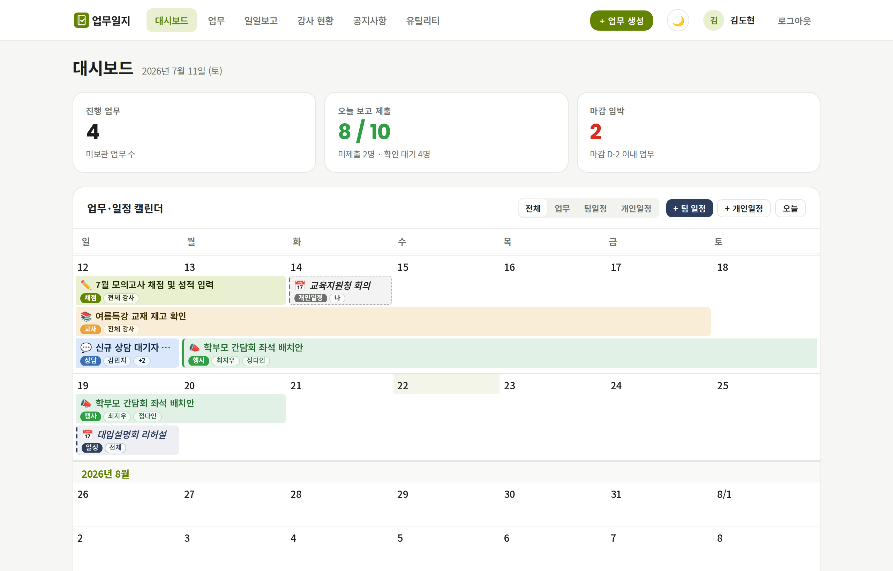
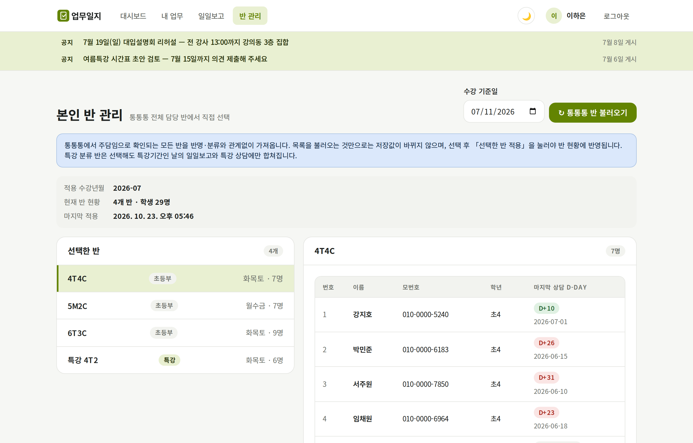
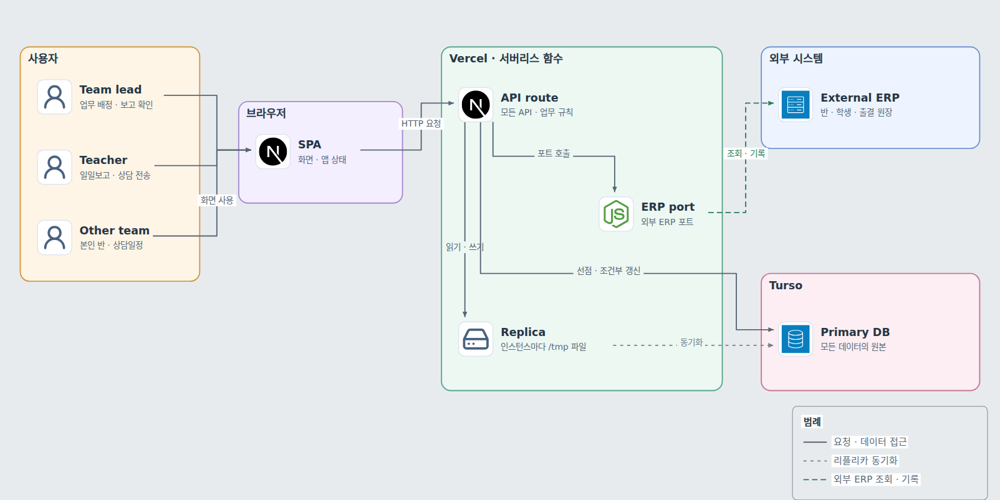

# 학원 강사 업무일지

팀장이 정한 업무와 날짜별 체크리스트를 강사가 다섯 단계로 확인해 제출하고, 상담 기록을 외부 ERP로 보내는 학원 사내 웹앱. 실제 학원에서 운영한 코드를 공개용으로 정리했고, 외부 ERP 연동은 같은 포트를 구현한 모의 구현으로 대체했음.

- 프로젝트 문서: [블로그 대문](https://gjaku1031.github.io/ken-blog/post/project-b17d9daa-5d61-4433-bfc3-710425d7cae7/)
- 개발 형태: 개발 1인, 기획 1인. 요구사항은 운영진과 각 팀의 팀장에게서 받음
- 운영 기록: 참여 13명(일일보고 대상 10명, 다른 팀 3명), 일일보고를 연 날 55일(2026-07-13 ~ 2026-09-23), 제출된 일일보고 493건

## 주요 기능

| 기능 | 사용자가 할 수 있는 일 |
| --- | --- |
| 업무 | 팀장이 기간과 완료 조건(텍스트 보고, 첨부)을 걸어 업무를 내면, 강사가 처리하고 보고함. 기간에 드는 날의 일일보고에 자동으로 나타남 |
| 일일보고 | 팀장이 날짜별 체크리스트를 정해 두면, 강사가 체크리스트·알림장·상담 확인·출결 확인·업무 확인의 다섯 단계를 마치고 제출함. 팀장이 읽고 확인 처리함 |
| 상담 전송 | 상담 업무를 받으면 반 명단을 외부 ERP에서 가져와 학생별로 상담을 쓰고 외부 ERP로 보냄. 부재·문자 연락도 따로 기록함 |
| 특강기간 | 팀장이 특강기간을 켜고 만든 날짜는 특강 보고로 고정되고, 그날의 알림장·출결은 일반 반과 특강 반을 함께 다룸 |
| 반 관리 | 외부 ERP의 반 목록을 불러와 강사마다 담당 반을 고름. 다른 팀은 본인 반과 상담일정, 알림장만 씀 |

## 화면

<picture>
  <source media="(prefers-color-scheme: dark)" srcset="docs/images/lead-dashboard-dark.png">
  
</picture>

<picture>
  <source media="(prefers-color-scheme: dark)" srcset="docs/images/teacher-classes-dark.png">
  
</picture>

화면의 이름·연락처·반은 모두 모의 구현이 만든 가상 데이터임.

## 핵심 문제와 결정

- **P1 외부 쓰기의 중복 방지**: 상담 전송을 원본 DB의 조건부 갱신으로 선점하고, 보내기 전후 외부 ERP의 같은 상담 수를 대조해 확정함. 결과를 모르는 전송은 다시 보내지 않고 사람이 확인할 때까지 남김(선점과 상태 전환 `src/api/store.service.ts`, 대조 규칙 `src/ttt/counsel-write.ts`)
- **P2 인스턴스 사이의 일관성**: 상태·보고 조회와 로그인 전에 원본을 당겨 오고, 겨루는 변경은 원본 DB의 트랜잭션에서, 긴 외부 조회를 낀 강사 반 갱신은 잠금 행과 상태 지문으로 막음(`pages/api/[[...slug]].ts`, `src/db/db.service.ts`)
- **P3 시점 고정**: 일일보고 날짜의 특강기간 여부와 특강상담의 대상 월·담당자·학생 명단을 만든 시점에 복사해 저장함(`src/api/store.service.ts`)

검토한 대안과 대가, 검증은 [주요 기술적 의사결정](https://gjaku1031.github.io/ken-blog/post/doc-f47c5aab-4b47-412a-a28c-db6f0c36a314/)에 있음.

## 아키텍처

<picture>
  <source media="(prefers-color-scheme: dark)" srcset="docs/images/architecture-dark.png">
  
</picture>

- 화면과 API가 Next.js 하나에 있고, 모든 요청은 Vercel의 API 함수 하나가 받음. 함수 인스턴스는 각자의 리플리카로 읽고 쓰며, 상담 전송의 선점처럼 인스턴스끼리 겨루는 변경만 Turso의 원본 DB에서 처리함
- 외부 ERP와는 API 함수 안의 포트(`src/ttt/ttt.gateway.ts`)를 거쳐서만 주고받음. 이 저장소의 포트 구현은 강사 이름·반 이름·날짜에서 결정적으로 자료를 만드는 모의 구현(`src/ttt/ttt.mock.ts`)임

흐름별 경로와 실패 시 동작은 [아키텍처](https://gjaku1031.github.io/ken-blog/post/doc-c2513d8a-31f4-49df-a99a-675fca3305a3/)에 있음.

## 기술 스택

| 영역 | 기술 |
| --- | --- |
| 화면·API | Next.js 14(Pages Router), React 18, TypeScript |
| 실행 | Vercel 서버리스 함수, Node.js 22 |
| DB | SQLite 계열 Turso(libSQL), 인스턴스마다 임베디드 리플리카 |

## 실행 (모의 모드)

```bash
pnpm install
cp .env.example .env.local   # APP_TODAY=2026-07-10 으로 바꿈(SEED_MODE는 이미 demo)
pnpm dev                     # http://localhost:3000
```

- 데모 계정: 팀장 `admin` / `1234`, 강사 `lee.he` / `1234`(그 밖의 계정은 `src/db/seed.ts`). 데모 데이터는 2026년 7월 둘째 주 기준이라 `APP_TODAY`를 그 주의 평일로 고정함
- 외부 ERP 설정은 필요 없음. 데모 강사는 모의 ERP 계정이 연결돼 있어 반 불러오기, 일일보고의 알림장·상담·출결 단계, 상담 전송을 바로 해 볼 수 있음
- 운영 모드: `npm run build && APP_SECRET=<임의 문자열> npm start`. 환경변수 설명은 `docs/operations.md`

## 테스트

```bash
npm test           # Node 내장 테스트 러너, 테스트마다 임시 SQLite, 외부 접속 없음
npx tsc --noEmit
npm run build      # 타입 오류가 있으면 빌드도 멈춤
```

GitHub Actions가 push와 PR마다 같은 세 단계를 돌림(`.github/workflows/ci.yml`).

P1은 상담 전송의 선점·확인·종결(`counsel-delivery-store.test.cjs`, `counsel-api-reconcile.test.cjs`)과 대조 규칙(`counsel-write.test.cjs`), P2는 읽기 일관성(`read-consistency-api.test.cjs`)과 반 갱신의 지문 검사·잠금(`regular-class-sync.test.cjs`), P3는 특강상담 명단 고정(`special-feature.test.cjs`)이 검증함.

## 문서

| 문서 | 내용 |
| --- | --- |
| [블로그 대문](https://gjaku1031.github.io/ken-blog/post/project-b17d9daa-5d61-4433-bfc3-710425d7cae7/) | 개발 배경, 핵심 문제, 담당 범위, 운영 기록 |
| [아키텍처](https://gjaku1031.github.io/ken-blog/post/doc-c2513d8a-31f4-49df-a99a-675fca3305a3/) | 시스템 구조, 요청 흐름, 일관성 처리 |
| [기능과 사용자 흐름](https://gjaku1031.github.io/ken-blog/post/doc-991f7c8f-bc6d-466d-a4ce-1c97311f953b/) | 역할별 화면과 업무·일일보고·상담 흐름 |
| [데이터 모델과 ERD](https://gjaku1031.github.io/ken-blog/post/doc-16e3e0ad-86d4-403d-88c6-2ef61a3fe47d/) | 테이블 관계와 제약 |
| [주요 기술적 의사결정](https://gjaku1031.github.io/ken-blog/post/doc-f47c5aab-4b47-412a-a28c-db6f0c36a314/) | 기술 스택과 P1~P3의 대안·대가·검증 |
| `docs/requirements.md` | 역할·기능·업무 규칙·알려진 제약 |
| `docs/architecture.md` | 레이어, 외부 ERP 포트, 데이터 계층 |
| `docs/data-model.md` | DB 스키마와 API 레퍼런스 |
| `docs/operations.md` | 환경변수, 로컬 실행, 테스트, 배포 |

## 담당 범위

요구사항 정리와 운영, 업무·일일보고 모델, 외부 ERP 전송의 선점과 대조, 서버리스 인스턴스 사이의 일관성 처리. 상세는 [블로그 대문](https://gjaku1031.github.io/ken-blog/post/project-b17d9daa-5d61-4433-bfc3-710425d7cae7/)에 있음.
