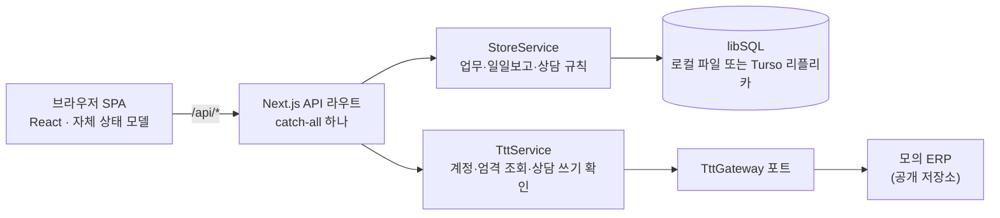

# NPR 업무일지

학원 초등부 팀장·강사가 업무 배정과 일일보고를 처리하는 웹앱. 실제 학원에서 시범 운영한 코드를 공개용으로 정리한 저장소이며, 외부 ERP의 실제 연동 구현은 빼고 같은 포트를 구현한 모의 구현으로 돌아가게 했음.

- 시범 운영: 13명(일일보고 대상 10명, 다른 팀 3명), 2026-07-13부터 2026-09-23까지 일일보고를 연 날 55일, 제출된 일일보고 493건
- 프로젝트 문서: [블로그 대문](https://gjaku1031.github.io/ken-blog/post/project-b17d9daa-5d61-4433-bfc3-710425d7cae7/)

## 주요 기능

| 기능 | 할 수 있는 일 |
| --- | --- |
| 업무 | 팀장이 업무를 만들어 전체 또는 지정 강사에게 배정하고, 시작일·마감일 사이의 일일보고에 자동으로 나타나게 함. 강사는 완료와 보고를 남김 |
| 일일보고 | 강사가 체크리스트 → 알림장 → 상담 확인 → 출결 확인 → 업무 확인의 5단계로 하루 한 번 제출하고, 팀장이 확인하거나 되돌림. 날짜별 체크리스트는 앞 날짜 항목을 복사해 만듦 |
| 상담 업무 | 반별 학생 명단에 상담을 쓰고 외부 ERP로 전송함. 전송 결과를 확인할 수 없으면 다시 보내지 않고 읽기만으로 재확인함 |
| 반 관리 | 외부 ERP에서 본인이 담임인 반과 학생 명단을 불러와 사용할 반을 고름. 학생별 연락처와 마지막 상담 경과일을 보여 줌 |
| 특강기간 | 팀장이 켜면 그날의 일일보고가 일반 반과 특강 반을 함께 다루고, 특강상담 업무는 생성 당시의 학생 명단을 고정함 |
| 다른 팀 | 일일보고 대상이 아닌 인원이 본인 반 알림장과 개인 상담일정만 쓰는 화면 |
| 주간테스트 PPT | 학생 목록 Excel과 외부 ERP 성적으로 우수 학생 슬라이드(PPTX·PDF)를 만듦 |

## 화면

<picture>
  <source media="(prefers-color-scheme: dark)" srcset="docs/images/lead-dashboard-dark.png">
  
</picture>

<picture>
  <source media="(prefers-color-scheme: dark)" srcset="docs/images/teacher-classes-dark.png">
  
</picture>

화면의 이름·연락처·반은 모두 모의 ERP가 만든 가상 데이터임.

## 핵심 문제와 결정

- **외부 ERP 상담 전송의 중복 방지**: 외부 ERP의 상담 저장은 비멱등이고 응답이 성공 여부를 알려 주지 않음. 저장 전 같은 원생·일자·주제·본문의 상담 수를 세고, 전송 시도를 DB에 먼저 기록한 뒤 한 번만 보내고, 다시 읽어 수가 늘었을 때만 성공으로 봄. 그 밖의 결과는 실패가 아니라 확인 불가로 남겨 읽기 전용 재확인으로만 확정함 (근거: 규칙 `src/ttt/counsel-write.ts`, 전송 상태 `src/api/store.service.ts`)
- **서버리스 인스턴스 사이의 읽기 일관성**: 인스턴스마다 로컬 리플리카가 따로 있어 방금 쓴 값을 다른 인스턴스가 못 볼 수 있음. 상태 조회 전에 원격에서 당겨 오고, 일일보고·상담·반 적용처럼 잃으면 안 되는 쓰기는 실패를 호출자에게 알리는 동기화와 원격 primary의 조건부 갱신을 씀 (근거: `pages/api/[[...slug)].ts`, `src/db/db.service.ts`]
- **외부 ERP를 포트 뒤로**: 화면과 업무 규칙은 `TttGateway` 포트만 알고, 계정 확인·엄격 조회·상담 쓰기 확인 규칙은 포트 위 서비스에 둠. 공개 저장소는 실제 구현 대신 강사 이름·반 이름·날짜에서 결정적으로 자료를 만드는 모의 구현을 넣어도 같은 흐름이 동작함 (근거: `src/ttt/ttt.gateway.ts`, `src/ttt/ttt.mock.ts`)

상세는 [요구사항](docs/requirements.md)과 [아키텍처](docs/architecture.md).

## 아키텍처

- 화면과 API가 한 Next.js 앱에 있고, API는 catch-all 라우트 하나가 경로별로 나눠 처리함
- 데이터는 libSQL에 두며, 서버리스 배포에서는 Turso 임베디드 리플리카로 원격과 동기화함

## 기술 스택

| 영역 | 기술 |
| --- | --- |
| 화면 | React 18, Next.js 14(Pages Router), 순수 CSS 디자인 토큰 |
| API | Next.js API 라우트, Node.js 22 |
| DB | libSQL(SQLite), Turso 임베디드 리플리카 |
| 문서 생성 | pptx-automizer, PDFKit, ExcelJS |

## 문서

| 문서 | 내용 |
| --- | --- |
| [docs/requirements.md](docs/requirements.md) | 역할·기능·업무 규칙·알려진 제약 |
| [docs/architecture.md](docs/architecture.md) | 레이어, 외부 ERP 포트, 데이터 계층, 요청 흐름 |
| [docs/data-model.md](docs/data-model.md) | DB 스키마와 API 레퍼런스 |
| [docs/operations.md](docs/operations.md) | 환경변수, 모의 ERP로 로컬 실행, 테스트, 배포 시 주의 |

## 담당 범위

개인 프로젝트. 요구사항은 학원의 실장·운영진·팀장에게서 받았고, 업무일지의 요구사항 정리와 시범 운영을 맡았음.
