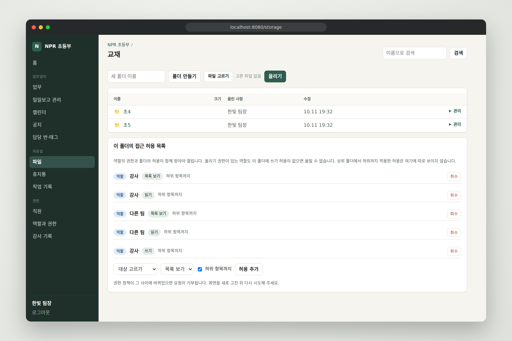
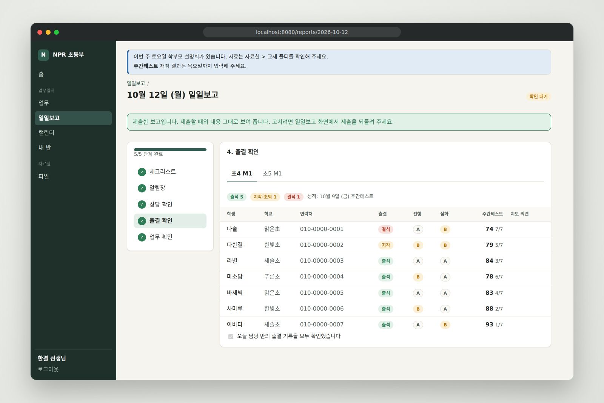
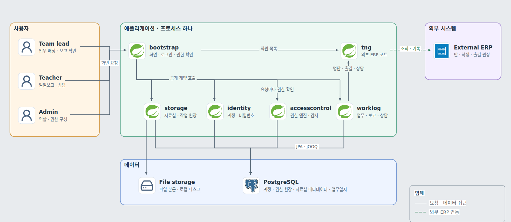

# npr-erp

학원 직원의 업무 지시, 일일보고, 자료 공유를 한곳에서 처리하고, 누가 무엇을 할 수 있는지를 학원이 직접 구성하는 사내 ERP. 로그인, 권한 엔진, 자료실, 업무일지를 하나의 Spring Modulith 애플리케이션으로 묶었음. 업무일지는 먼저 시범 운영한 기능이고, 이 저장소의 외부 ERP 연동은 계약이 비공개라 가상 구현으로 둠.

- 프로젝트 소개(대문): https://gjaku1031.github.io/ken-blog/post/project-b17d9daa-5d61-4433-bfc3-710425d7cae7/

## 주요 기능

| 기능 | 할 수 있는 일 |
| --- | --- |
| 업무 | 팀장이 업무를 내고 완료 조건(텍스트 보고, 첨부)을 걸면, 담당자가 처리하고 보고함. 담당자는 본인의 보고만 봄 |
| 일일보고 | 날짜별 체크리스트를 정해 두면, 강사가 다섯 단계를 마치고 제출함. 팀장이 읽고 확인 처리함 |
| 상담 전송 | 반 명단을 가져와 학생별로 상담을 쓰고 외부 ERP로 보냄. 전원에게 보내면 업무가 완료됨 |
| 자료실 | 폴더와 파일을 올리고 옮기고 휴지통으로 보냄. 폴더마다 역할이나 개인에게 목록·읽기·쓰기를 허용함 |
| 권한 관리 | 역할을 만들고 권한을 고르고 직원에게 배정함. 정책 변경과 엔진이 거부한 요청이 감사 기록에 남음 |

## 화면

<picture>
  <source media="(prefers-color-scheme: dark)" srcset="docs/images/readme/storage-dark.png">
  
</picture>

자료실의 폴더 화면. 아래 목록이 이 폴더에 걸린 접근 허용이고, 역할의 권한과 함께 맞아야 열림.

<picture>
  <source media="(prefers-color-scheme: dark)" srcset="docs/images/readme/report-dark.png">
  
</picture>

일일보고 4단계의 출결 확인 화면. 반별 출결과 과제, 주간테스트 성적을 외부 ERP 포트로 불러옴. 두 화면의 이름과 수치는 시연용 가상 데이터임.

## 핵심 문제와 결정

| 문제 | 결정 |
| --- | --- |
| P1 인가의 일관성: 상태를 바꾸는 요청과 화면을 여는 요청이 한 곳의 규칙으로 판단되고, 권한 정책을 동시에 고쳐도 서로 덮어쓰거나 폴더의 허용을 관리할 사람이 사라지지 않아야 함 | 소속과 학원 조건을 먼저 확인하고(ABAC), 역할의 권한(RBAC)과 폴더의 허용(ACL)을 함께 요구하는 엔진 하나로 판단. 정책 변경은 학원별 잠금과 정책 버전으로 직렬화 |
| P2 변경의 격리: 한 모듈이나 외부 시스템의 구현을 바꿔도 다른 모듈의 코드가 바뀌지 않아야 함 | 모듈을 공개 계약과 내부 구현으로 나누고 의존 방향을 빌드에서 검사. 업무 모듈은 권한 엔진에 의존하지 않고, 포트는 파일 저장소와 외부 ERP에만 둠 |
| P3 외부 상태와의 정합성: DB와 파일 저장소, DB와 외부 ERP가 중간 실패 뒤에도 어긋난 채로 남지 않고, 이 시스템이 같은 기록을 동시에 두 번 보내지 않아야 함 | 외부 호출을 기록·호출·확정으로 나누고, 끊긴 작업은 멱등한 재실행(파일 저장소)이나 외부 기록과의 대조(상담)로 마무리 |

대안과 대가, 검증은 [주요 기술적 의사결정](https://gjaku1031.github.io/ken-blog/post/doc-f47c5aab-4b47-412a-a28c-db6f0c36a314/)에 있음.

## 아키텍처

<picture>
  <source media="(prefers-color-scheme: dark)" srcset="docs/images/readme/system-dark.png">
  
</picture>

- **요청**: 화면 요청은 `bootstrap`의 컨트롤러가 권한 엔진(`accesscontrol`)에 물은 뒤 `storage`와 `worklog`를 부름
- **모듈**: 업무 모듈끼리는 서로 의존하지 않음. 반 명단과 출결은 `tng` 포트로 외부 ERP에서 읽고, 상담과 알림장은 같은 포트로 외부 ERP에 기록함. 이 저장소에는 포트의 구현으로 가상 데이터를 돌려주는 대역이 들어 있음
- **실행**: 애플리케이션 한 프로세스와 PostgreSQL 하나로 동작하고, 화면도 같은 프로세스가 그림

구성 요소와 일관성 보장 범위는 [아키텍처](https://gjaku1031.github.io/ken-blog/post/doc-c2513d8a-31f4-49df-a99a-675fca3305a3/)에 있음.

## 기술 스택

| 영역 | 기술 |
| --- | --- |
| 애플리케이션 | Java 25, Spring Boot 4, Spring Modulith, Spring Security |
| 영속성 | PostgreSQL, Flyway, JPA(Hibernate), jOOQ |
| 화면 | Thymeleaf(서버 렌더링) |

## 문서

블로그의 프로젝트 문서.

- [대문](https://gjaku1031.github.io/ken-blog/post/project-b17d9daa-5d61-4433-bfc3-710425d7cae7/)
- [아키텍처](https://gjaku1031.github.io/ken-blog/post/doc-c2513d8a-31f4-49df-a99a-675fca3305a3/)
- [기능과 사용자 흐름](https://gjaku1031.github.io/ken-blog/post/doc-991f7c8f-bc6d-466d-a4ce-1c97311f953b/)
- [데이터 모델과 ERD](https://gjaku1031.github.io/ken-blog/post/doc-16e3e0ad-86d4-403d-88c6-2ef61a3fe47d/)
- [주요 기술적 의사결정](https://gjaku1031.github.io/ken-blog/post/doc-f47c5aab-4b47-412a-a28c-db6f0c36a314/)
- [보안 설계](https://gjaku1031.github.io/ken-blog/post/doc-34b1ec9f-7d75-41d7-9f8c-b97463a05f0d/)

저장소 안의 문서.

- [설계 문서 목차](docs/README.md)
- [아키텍처 결정 기록](docs/adr/README.md)
- [개발 규칙](docs/development/conventions.md)
- [로컬 실행](docs/development/quickstart.md)

## 담당 범위

개인 프로젝트. 요구사항을 정리하고 권한 모델, 모듈 경계와 포트를 설계했으며 업무일지의 시범 운영을 맡았음. 상세는 [대문](https://gjaku1031.github.io/ken-blog/post/project-b17d9daa-5d61-4433-bfc3-710425d7cae7/)에 있음.
