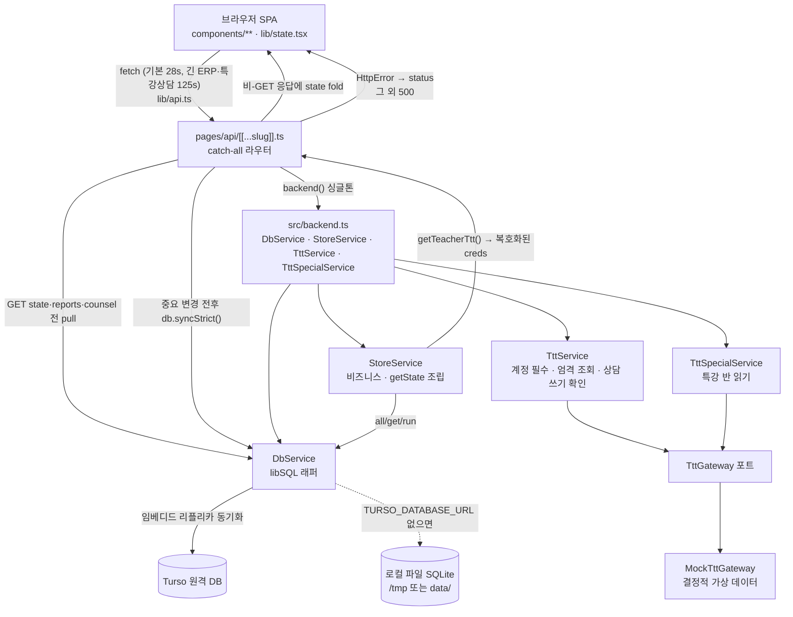

# 아키텍처

NPR 업무일지(일일보고) 관리 시스템의 실제 구조. 모든 내용은 소스를 직접 확인해 정리했다.

## 스택

| 구분 | 실제 사용 |
| --- | --- |
| 프레임워크 | Next.js `^14.2.35` — **Pages Router** (`pages/`) |
| UI | React 18.3.1 + TSX, 전 클라이언트 SPA |
| DB 드라이버 | `libsql@^0.5.29` (better-sqlite3 호환 API) |
| 영속 | 로컬 파일 SQLite / **Turso 임베디드 리플리카**(원격 동기화) |
| 외부 연동 | `TttGateway` 포트 + 모의 구현(`src/ttt/ttt.mock.ts`) |
| 런타임 | Node.js 22(`engines.node = 22.x`). 운영은 서버리스 함수로 배포했음 |

`package.json`에 프론트 상태관리 라이브러리(Redux/Zustand 등)나 CSS 프레임워크 의존성은 **없다**. 상태는 자체 구현, 스타일은 순수 CSS다.

## 레이어 구조

```
브라우저(SPA)
  └─ pages/api/[[...slug]].ts     단일 catch-all 라우터 (유일한 API 진입점)
       └─ src/backend.ts          프로세스당 1회 wiring (싱글톤)
            ├─ StoreService           비즈니스 규칙 · 상태 스냅샷 조립
            ├─ DbService              libSQL 영속 · 스키마/마이그레이션 · Turso sync
            ├─ TttService             강사별 외부 ERP 연동 규칙(포트 TttGateway 위)
            └─ TttSpecialService      학원 단위 특강 반 읽기
```

### `pages/api/[[...slug]].ts` — 라우팅 전담

- Next.js catch-all 하나가 **모든** `/api/*`를 처리한다. `route()` 내부에서 `[a, b1, b2, b3]` 경로 조각과 메서드로 분기하고, 매칭 실패 시 `undefined`를 반환해 404로 떨어뜨린다.
- `export const config = { maxDuration: 120 }` — 긴 외부 ERP 조회(반 명단·연락처)를 위한 상한이다.
- 예외는 `src/http-error.ts`의 `HttpError(status, message)`로 던지고, 라우터가 `status`로 매핑한다(그 외는 500).
- **읽기 일관성 처리**: `GET /api/state`, `GET /api/reports/...`, `GET /api/counsel/...` 직전에 `db.sync()`로 원격 pull한다. 일일보고 날짜 생성·업무 정의·상담·특강 설정/동기화는 오류를 전달하는 `db.syncStrict()`를 요청 전후에 쓴다. 정규/특강 동기화, 강사 생성·삭제, 외부 ERP 계정 저장은 원격 primary의 3분 mutation lease를 공유해 stale `teachers.classes` JSON이 서로를 덮지 않게 한다. 정규반 전체 교체는 추가로 긴 ERP 조회 전 상태의 SHA-256 guard를 원격 primary 트랜잭션 안에서 다시 비교한 뒤 모든 강사와 설정을 함께 갱신한다. `POST /api/teachers/:tid/classes`는 모든 반 그룹의 직접 수정을 400으로 거부하므로 mutation lease에 참여하지 않는다. 서버리스는 요청마다 다른 인스턴스가 각자 `/tmp` 리플리카를 갖기 때문이다.
- **fold-state**: 비-GET 응답에 `store.getState(role, tid)` 결과를 `state` 필드로 함께 실어 보낸다 → 클라이언트가 별도 `GET /api/state` 없이 즉시 반영(왕복 1회 제거). `login`/`ttt` 경로와 `null` 응답은 제외한다. `getState` 조립이 실패해도 변경 자체는 성공으로 응답한다(try/catch).
- `/api/health`는 DB 동기화 없이 `{ ok: true, warm: true }`만 반환 — 외부 핑으로 컨테이너를 웜 유지해 콜드스타트를 회피하는 용도. (경로 분기가 메서드를 보지 않아 GET 외 메서드에도 응답한다.)

### 서비스 경계

- **`src/api/store.service.ts`** — 앱의 모든 비즈니스 로직. 로그인 판정, 업무/일정/태그/공지/강사/일일보고 CRUD, 일반/특강 상담 로스터, 동기화 전용 일반·특강 반 및 다른 팀 본인 반 스냅샷의 원자 적용, 다른 팀 개인 상담일정, 모든 반 그룹 직접 수정 거부, 그리고 역할별 상태 스냅샷(`getState`) 조립. SQL은 `DbService` 래퍼(`all`/`get`/`run`)를 통해서만 호출한다.
- **`src/db/db.service.ts`** — 영속만 담당. 커넥션 생성, `init()`(스키마 적용 → 경량 마이그레이션 → 시드), 실패를 삼키는 `sync()`와 필수 영속용 `syncStrict()`, libSQL의 `_metadata` 필드를 제거하는 편의 래퍼.
- **`src/ttt/ttt.gateway.ts`** — 외부 ERP 포트(`TttGateway`). 알림장, 출결·상담·성적·명단, 본인 반·특강 반 스냅샷, 학생 연락처, 상담 목록 읽기와 상담 저장 요청을 정의한다. 계약 타입은 `ttt.records.ts`(기록)와 `ttt.special.ts`(반·원생 명단)에 있다.
- **`src/ttt/ttt.service.ts`** — 라우트가 쓰는 연동 서비스. 강사 본인 계정이 없으면 조회하지 않고, 일반 조회 실패는 빈 값으로, PPT 생성·반 적용·학생 상세 같은 작업은 엄격 조회로 실패를 그대로 알린다. `TttSpecialService`는 학원 단위 특강 반과 특강 원생 연락처를 읽는다.
- **`src/ttt/counsel-write.ts`** — 상담 쓰기 확인 규칙. 저장 전 같은 상담 수를 세고, 호출자의 시도 기록(`onBeforePost`) 뒤 저장 요청을 한 번 보내고, 다시 읽어 수가 늘었을 때만 성공으로 본다. 그 밖의 결과는 확인 불가(`TttCounselWriteIndeterminateError`)이며 읽기 전용 재확인(`reconcileCounselWrite`)으로만 확정한다. 포트의 기본 동작(반 코드 확인, 상담 목록 읽기, 저장 요청)만 쓰므로 어떤 구현 위에서도 같은 규칙이 적용된다.
- **`src/ttt/ttt.mock.ts`** — 공개 저장소의 유일한 포트 구현. 반·원생·성적·출결을 강사 이름·반 이름·날짜에서 결정적으로 만들고, 실제 ERP처럼 긴 상담 본문을 10자 미리보기로 돌려준다. 게시한 알림장과 저장한 상담은 프로세스 메모리에만 남는다.
- **`src/ttt/regular-class-sync.ts`** — 정규반 코드와 각 등록 강사 계정에서 보이는 canonical 반코드를 교차한다. 복수 계정에서 보이는 반은 후보 중 기존 담당자가 정확히 한 명일 때만 유지하며, 나머지는 전체 적용을 막는다.

`getState`는 역할 경계도 담당한다. 강사 뷰에서는 본인이 배정된 업무만 남기고, 각 업무의 `statuses`를 **본인 것만**으로 축소한다. 다른 팀 뷰는 본인 소유 `self_managed` 상담일정만 남기고 일일보고·팀 일정·공용 업무를 제거한다.

## `backend()` 싱글톤

`src/backend.ts`는 `DbService`/`StoreService`/`TttService`/`TttSpecialService`를 프로세스당 1회만 만든다. 두 연동 서비스는 같은 `MockTttGateway`를 공유하고, 모의 ERP의 직원 명단은 앱의 강사 명단을 따른다.

핵심은 **`db.init()`이 성공한 뒤에야 `_db`에 할당한다**는 점이다.

```ts
const db = new DbService();
db.init();
const store = new StoreService(db);
store.ensureFixedTags();
_store = store;
_ttt = new TttService(gateway);
_db = db;          // ← 마지막
```

`_db`를 먼저 할당하고 `init()`이 던지면, 다음 호출부터 `if (!_db)` 가드가 `false`가 되어 재초기화를 건너뛴다. 그 결과 `_store`/`_ttt`가 `null`인 상태로 프로세스 내내 고착되고, 모든 요청이 원인을 알 수 없는 null 참조 500으로 실패한다. 마지막에 할당하면 실패한 초기화는 아무 흔적을 남기지 않고 다음 요청에서 다시 시도된다.

## 데이터 계층

- `TURSO_DATABASE_URL`이 있으면 `new Database(file, { syncUrl, authToken })` → **임베디드 리플리카**. 로컬 파일은 캐시, 원격이 진실. 없으면 순수 파일 SQLite(+`journal_mode = WAL`).
- 파일 위치: `process.env.VERCEL`이면 `/tmp/app.sqlite`(서버리스), 아니면 `<cwd>/data/app.sqlite`.
- `init()`: (Turso면) pull → `SCHEMA_SQL` 적용(`CREATE TABLE IF NOT EXISTS`) → `migrate()`(PRAGMA table_info로 누락 컬럼 ALTER) → 시드. **실제 로컬 변경이 있을 때만** push해 콜드스타트 왕복을 아낀다.
- 시드 모드는 `SEED_MODE`로 결정: 기본 `clean`(`bootstrapClean` — 팀장 계정 + 기본 태그만), `demo`(`seedIfEmpty` — 프로토타입 샘플 데이터).
- 스키마는 `src/db/schema.ts`의 단일 DDL 문자열. 날짜는 전부 ISO `YYYY-MM-DD`로 저장하고 표시 라벨/D-day는 계산한다.

## 프론트 상태관리 — mutable model + render() tick

`lib/state.tsx`는 React state 트리 대신 **가변(mutable) 단일 모델 객체**를 쓴다.

```ts
const [, setTick] = useState(0);
const render = useCallback(() => setTick((t) => (t + 1) % 1000000000), []);
const ref = useRef<any>(null);
if (!ref.current) { /* App 객체 1회 생성 */ }
```

- `App`은 `useRef`에 담겨 재렌더와 무관하게 동일 인스턴스로 유지된다. 필드(`session`, `state`, `ui`, `viewReport`, `counselRows` …)를 **직접 변형**한 뒤 `App.render()`를 호출해 tick을 올리면 트리가 다시 그려진다.
- 컨텍스트는 `AppContext.Provider value={{ App, v: undefined }}`, 소비는 `useApp()`. 화면 컴포넌트는 `const { App } = useApp()`으로 모델과 액션에 모두 접근한다.
- `next.config.js`에 `reactStrictMode: false` — 낙관적 업데이트/외부 상태의 이중 렌더를 피하기 위한 설정이다.
- 부팅은 `useEffect(() => { App.boot(); }, [])` 한 번. `localStorage`의 `npr_session`을 복원한다.

### `act()` 헬퍼

```ts
function act(fn, msg?, optimistic?, lockKey?) { … }
```

1. `lockKey`가 있으면 `inflight` Set으로 **연타 차단**(공지 이중 등록 등 방지).
2. `optimistic()`을 먼저 실행하고 즉시 `render()` — 모달 닫기 등이 바로 반영된다.
3. `fn()` 응답에 `r.state`가 있으면(= 서버가 fold한 최신 상태) **그대로 `App.state`에 대입**하고 `render()`. 없으면 `App.reload()`로 폴백.
4. 실패 시 토스트 + `reload()`로 서버 상태에 재동기화.

즉 "서버가 계산한 뷰 상태를 클라이언트가 그대로 신뢰하고 갈아끼우는" 구조라, 클라이언트에 파생 로직을 중복 구현하지 않는다. 위저드처럼 로컬 UI 상태를 보존해야 하는 흐름은 `App.reloadKeepWizard()`로 `ui.wizard`를 되붙인다.

## 한글 IME 안전 입력

`render()` tick 방식은 아무 액션에서나 전역 재렌더를 유발한다. 그래서 초안 입력에는 **비제어(uncontrolled)** 패턴을 쓴다 — 코드가 밝힌 이유는 "타이핑 중 재렌더 없음(한글 IME 안전)"이다 (`components/ui.tsx`, `components/Markdown.tsx`). 제어 컴포넌트에서 한글 IME가 구체적으로 어떻게 깨지는지(조합 확정·중복·포커스 이탈 등)는 코드에 재현 기록이 없어 **미확인**이다.

- `DraftField` / `DraftTextArea`: `value` 대신 `defaultValue`만 받고, 값 변경은 `onInput` 콜백(내부적으로 `<input>`의 `onChange` 핸들러)으로 바깥 모델에 흘려보낸다. 타이핑 중 상위 리렌더가 발생하지 않으므로 DOM 노드가 그대로 유지된다.
- 값이 외부에서 바뀌어 다시 반영해야 하면 **상위에서 `key`를 바꿔 remount** 한다. 실제 사용처(`components/screens/Wizard.tsx`)가 `key={c + '-t'}` / `key={c + '-b'}`처럼 반 코드 기반 key를 주는 이유다.
- `components/Markdown.tsx`의 `MarkdownEditor`도 같은 이유로 `defaultValue` + `ref` 조합이며, 툴바 버튼은 `onMouseDown`에서 `preventDefault`로 포커스를 유지한 채 커서 위치/선택 영역에 마크다운을 삽입한다.
- 반면 `Field`/`TextArea`(제어형)는 로그인 폼처럼 **상위가 지역 `useState`로 관리해 같은 DOM 노드를 재사용**하는 곳에서 쓴다.

## 디자인 시스템과 캐시버스팅

- 토큰은 `public/tokens/`의 순수 CSS 파일이고, `_document.tsx`가 링크하는 건 `colors.css`, `typography.css`, `spacing.css`, `radius.css`, `elevation.css`, `base.css` 6개다(디렉터리의 `fonts.css`는 링크하지 않는다 — 웹폰트는 아래처럼 `_document.tsx`가 직접 건다). 컴포넌트 스타일은 `public/app.css`. 다크모드는 `<html class="dark">` 토글이다.
- `pages/_document.tsx`가 이 파일들을 `<link>`로 직접 건다(빌드 파이프라인을 타지 않아 디자인 원본이 그대로 보존된다). 웹폰트는 `@import` 체인 대신 `preconnect` + 직접 `link`로 FCP를 개선한다.
- **캐시버스팅**: `public/` 자산에는 콘텐츠 해시가 없으므로 쿼리로 버전을 붙인다.

  ```ts
  const V = process.env.VERCEL_GIT_COMMIT_SHA
    ? process.env.VERCEL_GIT_COMMIT_SHA.slice(0, 8)
    : String(Date.now());
  ```

  Git 연동 배포에는 커밋 SHA가 주입되지만 **CLI(`vercel deploy`) 배포에는 `VERCEL_GIT_COMMIT_SHA`가 없다.** 그래서 `Date.now()`로 폴백해 매 빌드마다 값이 갱신되게 한다. 모듈 스코프라 프리렌더 시 1회만 평가되어 배포별 고정값이 된다.
- `next.config.js`의 `headers()`가 `/app.css`, `/tokens/*`에 `max-age=3600, stale-while-revalidate=604800`을, 이미지에 `max-age=86400`을 준다. 해시가 붙는 `_next/static`은 Next가 이미 immutable 처리하므로 건드리지 않는다.
- 다크모드 깜빡임 방지: `_document.tsx` 인라인 스크립트가 React 렌더 전에 `localStorage.npr_dark`를 읽어 `dark` 클래스를 붙인다.

## 외부 ERP 자격증명

- 강사별 외부 ERP 아이디·비밀번호는 `teachers.ttt_id`·`ttt_pw`에 저장한다. 비밀번호는 `src/ttt/crypto.ts`가 AES-256-GCM으로 암호화하고, 키는 `APP_SECRET`에서 파생한다(`src/secret.ts`). 운영(`NODE_ENV=production`)에서 `APP_SECRET`이 없으면 기동하지 않고, 개발에서는 프로세스마다 임의 키를 만든다.
- 출결·상담·성적·명단 조회는 강사 본인 자격증명이 없으면 빈 배열을 반환한다. 공유 계정으로 다른 강사의 자료가 노출되지 않게 하기 위함이다.
- API 응답에는 `tttId`와 `hasTtt` 불리언만 실린다.

## 요청 흐름



## 주요 환경변수 (코드에서 실제로 읽는 것)

| 변수 | 용도 |
| --- | --- |
| `TURSO_DATABASE_URL` / `TURSO_AUTH_TOKEN` | 있으면 Turso 임베디드 리플리카 모드 |
| `SEED_MODE` | `clean`(기본) / `demo` |
| `LEAD_ID` / `LEAD_PW` / `LEAD_NAME` | 최초 부트스트랩 팀장 계정 (값은 `<플레이스홀더>`) |
| `APP_SECRET` | 외부 ERP 비밀번호 암호화·반 목록 확인 정보 서명 키 — 운영 필수 |
| `APP_TODAY` | 앱 기준 '오늘' 고정(미지정 시 KST 실제 날짜) |
| `VERCEL`, `VERCEL_GIT_COMMIT_SHA` | 서버리스 배포 플랫폼이 주입 — DB 경로 분기, CSS 캐시버스팅 |

> 전체 목록·기본값·운영 조치는 [operations.md](operations.md) §1이 정본이다.

## 빌드/배포 특이사항 (`next.config.js`)

- `libsql`은 네이티브 모듈이라 webpack 번들 대신 **런타임 require**로 externals 처리한다.
- `experimental.outputFileTracingIncludes`로 `/api/[[...slug]]` 함수에 `libsql`, `@libsql`, `@neon-rs`, `detect-libc` 바이너리를 명시 포함한다(externals라 자동 추적이 안 됨).
- `eslint.ignoreDuringBuilds`, `typescript.ignoreBuildErrors` 모두 `true` — 빌드가 타입 오류를 막지 않는다.
- 프론트는 `pages/index.tsx`에서 `dynamic(..., { ssr: false })`로 로드된다(브라우저 상태 의존).
