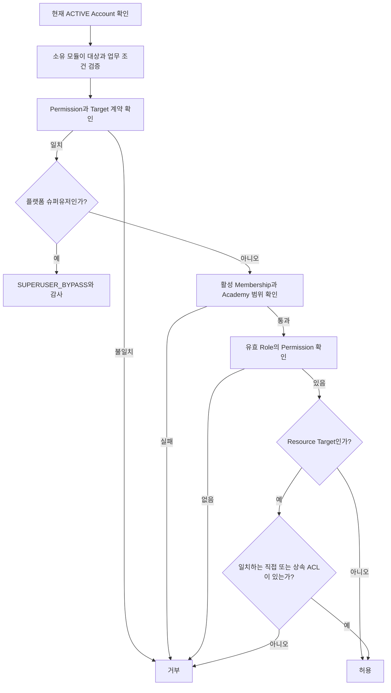

# 권한 엔진: RBAC·ABAC·ACL

NPR의 인가는 **역할로 기능 사용 자격을 얻고(RBAC), 계정 상태·학원 범위 같은 조건을 확인하며(ABAC),
개별 저장소 리소스에 허용된 작업을 검사하는(ACL)** 구조다. `accesscontrol`은 공통 판단과 권한 원장을,
`identity`와 리소스 소유 모듈은 각자만 확인할 수 있는 계정·업무 조건을 책임진다.

이 문서는 현재 코드의 판단 규칙, 공개 계약, 데이터 구조와 관리 계약을 설명한다.
자료실, 업무일지, 권한 관리에서 상태를 바꾸는 요청과 화면 하나를 여는 요청은 이 엔진을 거친다.
홈과 캘린더처럼 여러 구역을 한 화면에 모은 조회는 같은 요청에서 읽은 권한 요약으로 구역을 고른다. 요청별 연결은 [자료실](storage.md)과
[업무일지](worklog.md) 문서에 있다. 로그인·세션·CSRF는 [인증 문서](authentication.md)를 따른다.

목차: [세 가지 방식](#세-가지-방식의-역할) · [판단 흐름](#입력과-판단-흐름) ·
[Permission](#permission과-target-계약) · [ACL 사례](#acl-상속과-판단-사례) ·
[데이터·관리](#권한-원장과-관리-계약) · [사용 방법](#업무-기능에서-사용하는-방법) ·
[감사·진단](#감사와-거부-원인-확인) · [구현 경계·근거](#현재-구현-경계와-근거).

## 세 가지 방식의 역할

| 방식 | 판단하는 질문 | NPR 적용 |
|---|---|---|
| RBAC, Role-Based Access Control | 어떤 기능을 사용할 수 있는가? | 활성 Membership에 부여된 Role의 Permission으로 파일 읽기·역할 관리 등의 자격을 판단 |
| ABAC, Attribute-Based Access Control | 이 계정과 대상의 현재 조건이 맞는가? | Account·Membership·Role 상태, Academy 일치, 리소스 상태·조상 관계 등을 담당 경계에서 확인 |
| ACL, Access Control List | 이 리소스에서 어떤 작업이 허용되는가? | 특정 폴더에 Account 또는 Role의 `LIST`·`READ`·`WRITE`·`MANAGE_ACL` 허용을 부여 |

세 가지는 관리자·직원 같은 사용자 등급을 뜻하지 않는다. 일반 사용자의 리소스 접근에는 기능 Permission과
적용 가능한 ACL이 **둘 다** 필요하다. 역할 관리처럼 Academy 전체를 대상으로 하는 기능은 폴더 ACL을 요구하지 않는다.

### RBAC: 역할과 기능 권한

Account는 Academy의 `StaffMembership`을 통해 Role을 부여받는다. 하나의 Account가 여러 Academy에
소속될 수 있고, 같은 Membership에 여러 Role을 부여할 수 있다. 유효한 모든 Role의 Permission을 합쳐 평가한다.

- Role 이름은 관리자가 정하는 표시 정보다. `강사`를 `교사진`으로 바꿔도 Permission과 ACL 연결은 유지된다.
- `ACTIVE` Membership, 회수되지 않은 Assignment, `ACTIVE` Role만 평가에 사용한다.
- Permission은 `storage.file.read` 같은 코드 소유 키다. 관리자는 기존 키를 조합하며 새 키와 의미는 배포로 추가한다.
- Permission을 주는 Role과 ACL을 주는 Role이 달라도 현재 사용자가 둘 다 가지고 있으면 결합할 수 있다.
- 다른 Academy의 Role을 연결하거나 Role 계층·상속으로 Permission을 얻는 방식은 지원하지 않는다.

### ABAC: 상태와 범위 조건

현재 ABAC 성격의 조건은 타입이 정해진 코드에 들어 있다. 관리자가 임의 속성 식을 입력하는 정책 DSL이나
범용 Attribute Map은 없다. 모든 조건을 `AuthorizationPolicyEngine` 한 클래스에서 검사하는 구조도 아니다.

| 조건 | 확인하는 책임 |
|---|---|
| 로그인한 Account가 존재하고 `ACTIVE`인가? | `bootstrap`의 `AcademyContextInterceptor`가 요청마다 `identity.AccountDirectory.requireActive` 호출 |
| 요청 리소스가 존재하고 URL의 Academy에 실제로 속하는가? | 리소스 소유 모듈이 원장 조회 후 검증 |
| 부모·조상 관계와 리소스 상태가 작업에 적합한가? | 리소스 소유 모듈의 도메인 규칙 |
| 활성 Membership·유효 Role과 권한 Snapshot의 Academy가 맞는가? | `accesscontrol`의 조회와 순수 정책 계산 |
| Permission의 Target·리소스 종류·작업 조합이 맞는가? | `PermissionCatalog` 계약 검증 |

예를 들어 기능 권한이 있어도 다른 Academy의 파일을 자기 학원 URL에 끼워 넣어 접근할 수 없어야 한다.
이는 ACL 조회 이전에 리소스 소유 모듈이 막아야 하는 경계다. 슈퍼유저도 이 검증을 통과해야 한다.

**ReBAC와의 구분:** ReBAC(Relationship-Based Access Control)는 사용자와 대상 사이의 관계로 접근을 판단한다.
`강사 → 담당 반 → 재원 학생` 같은 관계가 대표적인 설명 사례다. NPR의 기존 결정은 RBAC·ABAC·ACL 조합이며,
독립적인 범용 ReBAC 엔진은 구현하지 않았다. [ADR-0004](../adr/0004-evolve-authorization-only-from-consuming-domain-requirements.md)에 따라
이런 관계는 원장을 가진 도메인이 확인한다. 업무일지가 그 사례다: "본인에게 배정된 업무인가", "본인 담당 반인가"는
`worklog`가 계정 ID로 확인하고, 그 기능을 쓸 자격은 공통 Permission 검사가 확인한다([ADR-0010](../adr/0010-worklog-on-account-ids-and-permissions.md)).

### ACL: 기능 권한을 적용할 리소스 범위

ACL 한 건은 Academy·리소스·주체·작업·상속 여부를 가진다. 주체는 Account 하나 또는 같은 Academy의 Role 하나다.
일치하는 허용이 없으면 거부하며, 명시적 `DENY` 항목은 없다. Account에 직접 ACL을 주더라도 활성 Membership과
Role을 통한 기능 Permission이 필요하다. 따라서 ACL만으로 파일 읽기 자격을 새로 만들 수 없다.

## 입력과 판단 흐름

공개 진입점은 [Authorizer](../../src/main/java/com/npr/erp/accesscontrol/Authorizer.java)다.
DB 조회와 감사는 `DefaultAuthorizer`, 조회된 값만으로 계산하는 일은 `AuthorizationPolicyEngine`이 담당한다.

| 입력·출력 | 계약 |
|---|---|
| `AuthorizationSubject` | 활성 상태를 확인한 `accountId`만 전달. 세션의 Role·Permission 목록을 전달하지 않음 |
| `AuthorizationRequest` | `subject`, `permission`, `target`, 선택적 추적 값 `requestId` |
| `AuthorizationTarget.Academy` | Academy 범위 기능의 `academyId` |
| `AuthorizationTarget.Resource` | 검증된 `ResourceContext`와 요구하는 `ResourceAction` |
| `ResourceContext` | 실제 `academyId`, `resourceType`, `resourceId`, Root부터 직접 부모 순서의 `ancestorResourceIds` |
| `AuthorizationDecision` | `allowed`, 안정적인 사유 `reason`, 적용 정책 `policy` |

`ResourceContext`는 서버가 실제 원장에서 만든다. 생성자는 자신을 조상에 넣거나 조상을 중복시키는 입력을
거부하지만, DB상의 존재·소유 학원·진짜 조상 관계까지 조회하지는 않는다. 클라이언트가 준 문맥을 그대로 신뢰하면 안 된다.



위 흐름의 첫 두 단계는 호출 측 책임이다. `Authorizer` 내부에서는 Permission 계약을 먼저 검증하므로,
슈퍼유저도 알 수 없는 Permission이나 잘못된 action 조합으로 허용받을 수 없다.
일반 사용자는 활성 소속 → Academy 범위 → Permission → 필요한 ACL 순으로 평가하고 첫 실패 사유를 반환한다.

플랫폼 슈퍼유저는 `platform_superuser`의 현재 등록 여부로 판단한다. 정상 요청의 Membership·Role·Permission 보유·ACL은
우회하지만 인증, Account 활성 상태, 리소스 무결성, 도메인 불변조건과 정책 변경의 잠금·버전 검사는 유지한다.
Academy Role에 `SYSTEM_ADMIN`이라는 이름을 붙여도 플랫폼 자격은 생기지 않는다.

결과의 정책 코드는 `SUPERUSER_V1`(슈퍼유저 전용 경계), `ACADEMY_V1`(학원 기능), `RESOURCE_V1`(리소스 기능)이다.
일반 `Authorizer`의 슈퍼유저 우회도 Target에 맞는 `ACADEMY_V1` 또는 `RESOURCE_V1`과 `SUPERUSER_BYPASS`를 반환한다.
이 세 코드는 앞의 RBAC·ABAC·ACL 분류와 다른, 판단 경로 식별자다.

## Permission과 Target 계약

현재 [PermissionCatalog](../../src/main/java/com/npr/erp/accesscontrol/PermissionCatalog.java)는 27개 키를 정의한다.
Resource Target은 모두 `ResourceType.STORAGE_NODE`이며, Permission마다 action이 정확히 정해져 있다.

| Permission | Target | ACL action | 용도 |
|---|---|---|---|
| `access.membership.read` / `.manage` | Academy | 없음 | 학원 소속 조회 / 생성·종료 |
| `access.role.read` / `.manage` | Academy | 없음 | 역할·권한 목록 조회 / 역할 생성·이름 변경·비활성화·Permission 교체 |
| `access.assignment.read` / `.manage` | Academy | 없음 | 역할 배정 조회 / 교체 |
| `access.audit.read` | Academy | 없음 | 감사 기록 조회 |
| `storage.folder.list` | Resource | `LIST` | 폴더 하위 목록 |
| `storage.folder.create` | Resource | `WRITE` | 부모 폴더 아래 폴더 생성 |
| `storage.file.read` | Resource | `READ` | 파일 내려받기 |
| `storage.file.write` | Resource | `WRITE` | 폴더에 파일 올리기 |
| `storage.acl.read` | Resource | `READ` | 폴더에 직접 설정된 ACL 조회 |
| `storage.acl.manage` | Resource | `MANAGE_ACL` | 폴더 ACL 부여·회수 |
| `storage.node.modify` | Resource | `WRITE` | 이름 변경·이동·휴지통·복원 |
| `storage.node.delete` | Resource | `WRITE` | 영구 삭제 |
| `worklog.task.manage` / `.perform` | Academy | 없음 | 업무 배정·전체 진행 조회 / 배정받은 업무 처리 |
| `worklog.journal.manage` | Academy | 없음 | 날짜별 일일보고 항목과 설정 관리 |
| `worklog.report.write` / `.review` | Academy | 없음 | 본인 일일보고 작성 / 제출 현황 조회와 확인 |
| `worklog.notice.manage`, `worklog.event.manage`, `worklog.staff.manage` | Academy | 없음 | 공지 / 팀 일정 / 담당 반 연결과 태그 관리 |
| `worklog.calendar.use`, `worklog.counsel.write`, `worklog.notebook.write`, `worklog.selfclass.manage` | Academy | 없음 | 캘린더와 개인일정 / 상담 작성·전송 / 알림장 / 본인 반 직접 관리 |

DB의 `permission` 표와 이 목록이 같은지는 통합 테스트가 확인한다. 새 키는 마이그레이션과 목록에 함께 추가한다.

`LIST`, `READ`, `WRITE`, `MANAGE_ACL` 사이에는 자동 포함 관계가 없다. `WRITE` ACL이 있어도 `READ`가 자동 허용되지 않고,
`MANAGE_ACL`만 있어도 ACL 조회에 필요한 `storage.acl.read`와 `READ`는 별도로 필요하다.
같은 `WRITE` action을 쓰는 기능들도 각자의 Permission이 있어야 한다.

권한 키 문자열의 형식이 맞아도 카탈로그에 없으면 `UNKNOWN_PERMISSION`이다. Academy Permission을 Resource Target에
쓰거나 `storage.file.read`에 `WRITE`를 조합하면 `PERMISSION_TARGET_MISMATCH`다.
자료실의 요청마다 어떤 키를 쓰는지는 [자료실 문서](storage.md#권한-연결)의 표가 원본이다.

## ACL 상속과 판단 사례

제품의 v1 계약은 **폴더에 ACL을 설정하고 파일은 부모·조상 폴더의 ACL을 사용하는 것**이다.
엔진은 파일·폴더를 공통 `STORAGE_NODE`로 받으므로, ACL 관리 대상이 실제 폴더인지 확인하는 책임은 소유 모듈에 있다.
파일별 ACL 관리와 상속 차단은 현재 제품 범위에 없다.

엔진은 요청과 Academy·리소스 종류·action이 같고, 현재 Account 또는 유효 Role에 해당하는 ACL만 후보로 삼는다.
직접 ACL은 현재 리소스에 적용하며, 조상 ACL은 `inherit_to_children=true`일 때만 적용한다.
여러 후보가 일치하면 직접 ACL, 그다음 가장 가까운 조상 ACL을 선택한다.
모두 `ALLOW`이므로 이 선택은 허용 근거를 고르는 규칙이며, 하위 ACL이 상위 허용을 취소하는 규칙은 아니다.

예시로 Root 아래 `교재` 폴더와 그 안의 파일이 있다고 하자. 아래 결과는 계정·학원·리소스 검증을 통과한 일반 사용자를 기준으로 한다.
별도 언급이 없으면 활성 Membership과 `storage.file.read` Permission이 있다고 가정한다.

| 구성·요청 | 결과 | 이유 |
|---|---|---|
| `storage.file.read` + `교재`의 상속 가능한 `READ`로 파일 읽기 | 허용 | 기능 자격과 조상 ACL 모두 충족 |
| 파일 읽기 Permission만 있고 적용할 `READ` ACL이 없음 | 거부 | `ACL_NOT_GRANTED` |
| Account의 `READ` ACL만 있고 파일 읽기 Permission이 없음 | 거부 | `MISSING_PERMISSION` |
| 부모 `READ`의 상속이 꺼져 있고 다른 허용 경로가 없음 | 거부 | 해당 ACL은 부모 자신에게만 적용 |
| Root에 상속 가능한 `READ`, 하위 폴더에는 상속 꺼진 직접 `READ` | 하위 파일도 허용 | 하위 설정이 Root의 허용을 차단하지 않음 |
| Role A가 파일 읽기 Permission, Role B가 `READ` ACL을 제공 | 허용 | 두 Role이 모두 유효하면 결합 가능 |
| 읽기 구성이 같아도 Membership이 종료됨 | 거부 | ACL 평가 전에 `MEMBERSHIP_INACTIVE` |

하위 파일 접근을 실제로 회수하려면 직접 ACL뿐 아니라 계속 적용되는 조상·다른 Role·Account의 허용 경로도 확인한다.
ACL 관리 API의 `list`는 해당 리소스에 **직접 설정된 항목**을 반환하며, 상속까지 합친 최종 권한 목록은 아니다.

## 권한 원장과 관리 계약

권한은 PostgreSQL이 원장이다. 세션에는 Membership·Role·Permission·ACL Snapshot을 장기 보관하지 않으며,
각 인가 호출에서 현재 상태를 조회한다. `DefaultAuthorizer`는 읽기 전용 `REPEATABLE_READ`로 선언되어 있다.
커밋된 회수는 이후 새 인가 조회에 반영되며, 이미 진행 중인 요청이나 발급된 파일 전송을 자동 취소하는 계약은 아니다.

| 테이블 | 소유 데이터·핵심 제약 |
|---|---|
| `account` | `identity` 소유의 로그인 계정과 상태. 인증 상세는 별도 문서 참조 |
| `academy_access_scope` | Academy의 Root 리소스 ID와 `policy_version` |
| `staff_membership` | Account의 Academy 소속. Account·Academy별 활성 소속은 하나 |
| `academy_role` | Academy별 역할 이름·상태. 같은 학원의 정규화 이름 중복 금지 |
| `permission` / `role_permission` | 배포로 관리하는 기능 키와 Role별 연결 |
| `role_assignment` | Membership·Role 연결과 회수 상태. 복합 FK로 같은 Academy 연결을 강제 |
| `resource_acl` | Account 또는 Role 중 하나를 주체로 지정. 동일 대상·주체·action 중복 금지 |
| `platform_superuser` | 플랫폼 슈퍼유저의 현재 등록 상태. Academy Role과 분리 |
| `authorization_audit_log` | 판단·변경·거부 사유, 정책 버전과 변경 전후 상태 |

스키마 원본은 [V1 마이그레이션](../../src/main/resources/db/migration/V1__identity_and_access_control.sql)이다.
`resource_acl.resource_id`는 Storage 테이블 FK가 없으므로 실제 존재와 생명주기 정합성을 소유 모듈이 보장해야 한다.

### 초기화와 관리자 변경

`AcademyAccessInitializer`는 첫 scope·Membership·Role·Permission·Assignment·Root ACL을 한 트랜잭션에 만든다.
호출 측은 실제 Root와 첫 관리자의 활성 Account를 검증하고, 초기화 실행자는 플랫폼 슈퍼유저여야 한다.
첫 Role에는 `storage.acl.manage`가 필수이며, 해당 Role에 상속 가능한 Root `MANAGE_ACL`을 부여한다.
다른 Root action은 첫 Role에 설정한 Storage Permission에 맞춰 추가하고 정책 버전은 1로 시작한다.

일반 권한 관리도 같은 `Authorizer`를 통과한다. Membership·Role·Assignment 관리는 각각 대응하는 Academy Permission을,
ACL 관리는 해당 폴더의 Permission과 ACL을 요구한다. Role 이름을 보고 관리자를 판정하지 않는다.
Role-Permission과 Membership-Role 변경은 **변경 후 전체 집합으로 교체**하고, ACL은 항목별 grant/revoke로 변경한다.

변경 유스케이스의 공통 순서는 다음과 같다.

1. Academy별 transaction advisory lock을 획득한다. 아직 scope 행이 없는 초기화 경쟁도 직렬화한다.
2. 현재 정책으로 변경 요청자를 인가하고 scope 행을 `FOR UPDATE`로 잠근다.
3. 요청의 `expectedPolicyVersion`을 현재 값과 비교한다. 다르면 `POLICY_VERSION_MISMATCH`로 거부한다.
4. 변경을 적용하고, 관리자 경로를 없앨 수 있는 변경이면 마지막 ACL 관리자 보호 조건을 검사한다.
5. 실제 상태 변경이 있으면 버전을 올리고 변경 감사와 함께 커밋한다. 동일 상태 요청은 버전·변경 감사를 추가하지 않는다.

예를 들어 두 관리자가 버전 7을 읽고 변경하면 첫 변경은 8을 반환하고, 뒤의 요청은 충돌로 거부된다.
화면은 최신 정책을 다시 읽고 변경 내용을 재검토해야 한다. 새 버전 숫자만 붙여 이전 전체 집합을 덮어쓰지 않는다.
위 버전 계약은 Academy 정책용이며, 플랫폼 슈퍼유저 변경은 별도 잠금과 운영 명령을 사용한다.

### 마지막 ACL 관리자 보호

각 Academy에는 활성 Membership과 유효 Role 배정을 통해 **`storage.acl.manage`와 Root `MANAGE_ACL`을 함께 가진 경로**가
하나 이상 남아야 한다. Role 비활성화, Permission 교체, 역할 배정 회수, Membership 종료, ACL 회수로 마지막 경로가 사라지면
`LAST_ACL_MANAGER_REMOVAL`로 변경 전체를 롤백한다. Permission Role과 ACL Role은 달라도 된다.

### 권한 관리 권한의 범위

`access.role.manage`, `access.assignment.manage`, `access.membership.manage`는 서로를 막지 않는다. 역할을 고칠 수 있는
사람은 자기 역할에 다른 권한을 넣을 수 있고, 배정을 고칠 수 있는 사람은 자신에게 역할을 줄 수 있다. 셋 가운데 하나를
가진 사람은 **그 학원 안에서는 관리자와 같다**고 보고 부여해야 한다. 마지막 ACL 관리자 보호는 권한이 사라지는 것만 막고
늘어나는 것은 막지 않는다. 이 권한들이 닿지 않는 것은 학원 밖이다: 플랫폼 슈퍼유저 자격은 화면으로 줄 수 없고,
비밀번호는 이 학원에만 활성 소속이 있는 계정의 것만 바꿀 수 있다.

플랫폼 슈퍼유저는 이 계산에 포함하지 않는다. 이 보호 조건은 Root ACL 관리 경로를 유지하는 계약이며,
모든 관리 기능의 Permission을 보장하지는 않는다. 또한 `identity`의 Account 정지는 계산 범위 밖이므로,
유일한 관리자 Account가 정지되면 실제 업무 접근이 막힐 수 있다.
계정·슈퍼유저 조치는 [운영 절차](../operations/accounts.md)를 따른다.

## 업무 기능에서 사용하는 방법

화면 요청을 받는 `bootstrap`의 컨트롤러가 권한을 강제하는 지점(PEP)이다. 컨트롤러는 `Guard`를 통해 엔진에 묻고,
허용되면 업무 모듈의 공개 계약을 부른다. 업무 모듈은 권한 엔진에 의존하지 않는다.

단건 Resource 작업은 활성 주체와 서버가 검증한 문맥을 만든 뒤 엔진을 호출한다. `require`는 거부되면 예외를 던진다.

```java
var location = storageCatalog.locate(academyId, nodeId);   // 실제 원장에서 노드와 조상을 읽음
var resource = new ResourceContext(academyId, ResourceType.STORAGE_NODE, nodeId, location.ancestorIds());
authorizer.require(new AuthorizationRequest(
        subject,
        PermissionCatalog.STORAGE_FILE_READ.key(),
        new AuthorizationTarget.Resource(resource, ResourceAction.READ),
        requestId));
// 이 검사를 통과한 뒤에만 파일을 연다.
```

`authorize`는 결정 값을 반환하므로, 직접 부를 때는 호출자가 거부 결과에서 작업을 중단해야 한다.
버튼을 숨기는 것으로 이 검사를 대체할 수 없다. 외부 I/O는 인가 이후에 수행하고 그동안 DB 트랜잭션을 유지하지 않는다.

| 작업 | 사용 계약과 주의점 |
|---|---|
| 학원 기능 검사 | 해당 Permission과 `AuthorizationTarget.Academy(academyId)` 사용 |
| 목록·검색 | `filterPermitted`에 같은 Academy·ResourceType의 중복 없는 문맥 목록 전달. 반환한 허용 ID로 결과를 제한 |
| 폴더 ACL 관리 | 폴더와 Academy·조상을 검증한 뒤 `ResourceAclManagement` 호출 |
| 리소스 생명주기에 따른 ACL 정리 | 작업 권한을 먼저 검증한 신뢰된 호출자가 `ResourceAclLifecycle.revokeAll` 사용. 사용자용 관리 Permission을 다시 요구하지 않으며 Root는 정리 불가 |
| 메뉴·버튼 표시 | `AcademyCapabilityReader`의 Permission 집합을 힌트로 사용하고 실제 작업 시 다시 인가 |
| 대상 집합 구하기 | `AcademyCapabilityReader.accountIdsWith`로 어떤 Permission을 가진 계정을 조회. 업무일지의 담당자·보고 대상에 씀 |

목록 필터는 공통 권한 Snapshot과 ACL 후보를 일괄 조회하고 메모리에서 각 리소스를 평가한다.
빈 입력은 빈 집합을 반환하며 Academy·종류 혼합이나 중복 ID는 잘못된 호출로 거부한다.
항목별로 `authorize`를 반복하는 방식의 DB 조회를 피할 수 있지만, SQL 검색·정렬·페이지네이션을 대신해 주지는 않는다.
상위 폴더 목록 접근 허용만으로 모든 자식의 접근을 허용하지 말고, 반환 대상도 필요한 action으로 필터링해야 한다.

`AcademyCapabilityReader.capabilities`는 `academyId`, `policyVersion`, `superuser`, `permissions`를 돌려준다.
일반 사용자는 활성 Membership의 Permission, 슈퍼유저는 전체 목록을 받는다. 소속이 없으면 거부되고, 초기화되지 않은
Academy는 찾을 수 없다고 답한다. 이 값은 개별 폴더 ACL을 평가하지 않는다. 화면은 이 집합에 없는 Permission에 대해서는
엔진에 묻지 않고 버튼을 감춘다. 버튼을 보여 줄지 정하려고 물은 것이 거부 감사 기록으로 쌓이지 않게 하기 위함이다.

## 감사와 거부 원인 확인

`AuthorizationDecision`은 내부 ACL·Role 식별자를 포함하지 않는다. 단건 거부와 슈퍼유저 우회는 업무 롤백에도 남도록
별도 트랜잭션으로 감사하고, 성공한 정책 변경 감사는 변경 상태와 같은 트랜잭션에 기록한다.
변경 전후 상태는 JSON 객체로 저장하며 `requestId`, Account·Academy·리소스, Permission과 정책 버전으로 추적한다.

모든 일반 허용을 기록하는 구조는 아니다. 목록의 공통 사유 거부와 슈퍼유저 우회는 batch 이벤트로 기록하며,
정상 목록 필터에서 개별 항목이 ACL 때문에 제외될 때마다 감사 행을 남기지는 않는다.

| 사유 코드 | 뜻·확인할 지점 |
|---|---|
| `UNKNOWN_PERMISSION` | 코드 카탈로그에 등록되지 않은 키인지 확인 |
| `PERMISSION_TARGET_MISMATCH` | Target 종류·ResourceType·action 조합 확인 |
| `MEMBERSHIP_INACTIVE` | 대상 Academy의 활성 소속 확인 |
| `ACADEMY_SCOPE_MISMATCH` | 권한 Snapshot과 대상 Academy의 일치 확인 |
| `MISSING_PERMISSION` | 활성 Role·회수되지 않은 Assignment와 Permission 연결 확인 |
| `ACL_NOT_GRANTED` | 정확한 action, Account·Role 주체, 직접·조상 ACL과 상속 여부 확인 |
| `SUPERUSER_REQUIRED` | 슈퍼유저 전용 진입점의 현재 등록 상태 확인 |
| `ALLOWED` / `SUPERUSER_BYPASS` | 일반 규칙 통과 / 플랫폼 자격에 의한 우회 허용 |

거부 결정은 `AuthorizationDeniedException`이 되고 화면은 403 오류 화면을 보여 준다. 화면에는 거부 사유 코드를
노출하지 않으며, 사유는 감사 기록에서 확인한다. 정책 버전 불일치·마지막 관리자 충돌·잘못된 관리 입력은
요청을 보낸 화면으로 돌려보내며 문구를 띄운다. 요청마다 `X-Request-Id`를 붙이고 감사 기록에 같은 값을 남긴다.

## 현재 구현 경계와 근거

| 구분 | 상태 |
|---|---|
| 공통 권한 엔진 | 단건·목록 평가, PostgreSQL 원장, 슈퍼유저, 감사·동시성·관리자 보호 구현 |
| 권한 관리 화면 | 직원·역할·역할별 권한·역할 배정·감사 기록 조회 연결 |
| 자료실 연결 | 요청별 Permission·ACL 강제, 목록·검색 필터, 폴더 ACL 화면, 영구 삭제 때의 ACL 정리 연결 |
| 업무일지 연결 | 기능별 Permission 강제. 담당·소유 조건은 `worklog`가 확인 |
| 범용 확장 | TEAM·CLASSROOM scope, Role 상속, 명시적 DENY·상속 차단·파일별 ACL, 범용 ABAC·ReBAC 엔진, 권한 캐시는 미구현 |

엔진 확장은 소비 도메인의 구체적인 요구가 생길 때 검토하며, 의미가 바뀌는 결정은 새 ADR로 기록한다.

세부 계약을 확인할 코드와 기존 테스트는 다음과 같다. 테스트 링크는 검증 시나리오의 위치이며 실행 결과를 의미하지 않는다.

| 확인할 내용 | 원본 |
|---|---|
| 순수 판단·ACL 우선순위 | [AuthorizationPolicyEngine](../../src/main/java/com/npr/erp/accesscontrol/internal/authorization/AuthorizationPolicyEngine.java), [단위 테스트](../../src/test/java/com/npr/erp/accesscontrol/internal/authorization/AuthorizationPolicyEngineTest.java) |
| 조회·슈퍼유저 분기·목록 감사 | [DefaultAuthorizer](../../src/main/java/com/npr/erp/accesscontrol/internal/authorization/DefaultAuthorizer.java), [동작 통합 테스트](../../src/test/java/com/npr/erp/integration/accesscontrol/AuthorizationBehaviorIntegrationTest.java) |
| ACL 부여·회수·생명주기 | [ResourceAclManagement](../../src/main/java/com/npr/erp/accesscontrol/ResourceAclManagement.java), [ACL 통합 테스트](../../src/test/java/com/npr/erp/integration/accesscontrol/ResourceAclIntegrationTest.java) |
| 마지막 관리자·경쟁 변경 | [LockoutGuardQuery](../../src/main/java/com/npr/erp/accesscontrol/internal/scope/LockoutGuardQuery.java), [보호·동시성 테스트](../../src/test/java/com/npr/erp/integration/accesscontrol/AccessControlLockoutIntegrationTest.java) |
| 화면 요청의 권한 강제 | [Guard](../../src/main/java/com/npr/erp/bootstrap/web/Guard.java), [화면 권한 테스트](../../src/test/java/com/npr/erp/integration/web/WebAccessIntegrationTest.java) |

결정 배경은 [ADR-0002](../adr/0002-admin-managed-authorization-and-system-superuser.md)의 관리자 구성형 권한,
[ADR-0003](../adr/0003-separate-platform-superuser-from-academy-rbac.md)의 플랫폼 슈퍼유저 분리,
[ADR-0004](../adr/0004-evolve-authorization-only-from-consuming-domain-requirements.md)의 도메인 요구 기반 확장을 따른다.
